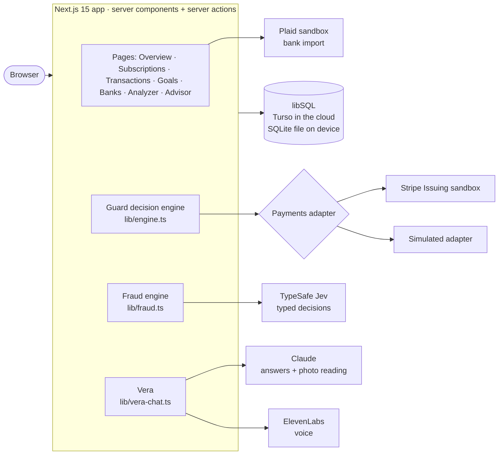
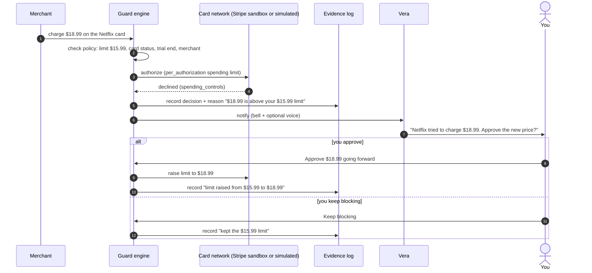
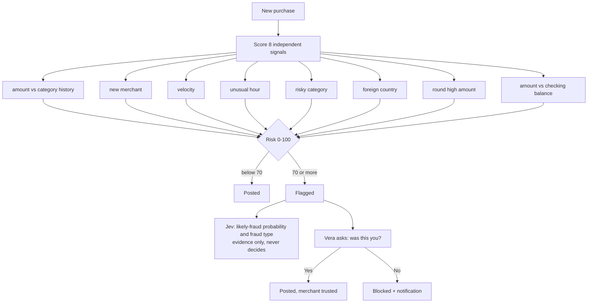
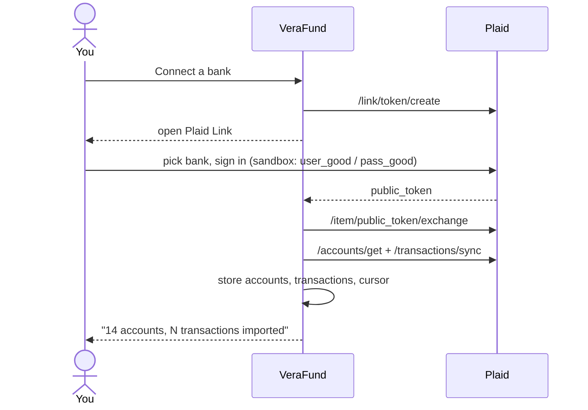
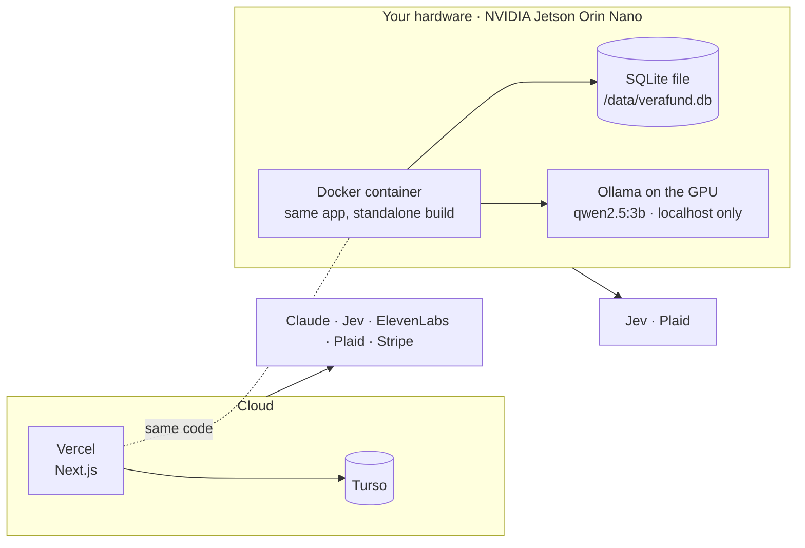
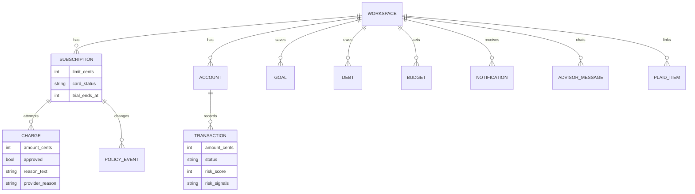

# VeraFund

**Subscriptions that ask before they charge.** VeraFund gives every subscription its own virtual card with a hard price cap. Price hikes wait for your approval, free trials lock before they convert, and suspicious charges are flagged with a plain-English reason. Vera, the built-in assistant, answers money questions by text or by voice.

**Live:** https://verafund.vercel.app · **QA:** core flows verified by Seldon's Wren agent (see `wren-results/`)

| Area | What it does |
|---|---|
| **Subscription Guard** | One card per subscription with a per-charge limit. Above-limit charges are declined; you approve the new price or keep blocking. Trial cards lock when the trial ends. Every decision is logged as evidence. |
| **Fraud detection** | An 8-signal, explainable risk score for every purchase, optional Jev triage, and Vera asking "was this you?" before anything is settled. |
| **Overview** | Net worth, income vs spending, category breakdown, budgets, upcoming bills inferred from history, 30-day cash-flow forecast, card optimizer. |
| **Banks** | Plaid Link (sandbox) imports accounts and transactions. Loans and credit lines count as debt. Incremental sync. |
| **Goals & Debt** | Savings goals with the monthly amount needed, avalanche vs snowball payoff planner, editable budgets. |
| **Vera** | A chat on every page (and a full Advisor page) grounded in your real data, plus hands-free "Call Vera" with an ElevenLabs voice. |
| **Purchase Analyzer** | Type a price or upload a photo: hours of work it costs, budget impact, and how many weeks it delays each goal. |

Blocking a card stops charges on that card. It does **not** cancel your contract with the merchant, and the UI says so.

---

## Architecture



**Principle: rules decide, AI explains, you approve.** Card limits and fraud scoring are deterministic and unit-tested. Jev and Claude rank, classify and explain, but never move money on their own.

## How a subscription charge is decided



Free trials follow the same path: when the trial ends the card is set to inactive, so the first paid charge is declined with "Free trial ended".

## How a suspicious purchase is handled



## Bank connection (Plaid)



## Deployment



The database layer is libSQL, so the same code talks to Turso in the cloud or to a local SQLite file on the Jetson.

### Private mode (on-device AI)

With `LLM_PROVIDER=ollama`, Vera's language model runs on the Jetson's GPU instead of the cloud, and the header shows **On-device AI**. Photo reading turns off, because it needs Claude and private mode keeps photos on the device.

Measured on a Jetson Orin Nano 8GB (JetPack 6.0, 15 W mode) with `python3 scripts/llm-bench.py`:

| Model | Decode | Prompt processing | Cold load | GPU | Board power | Tool choice |
|---|---|---|---|---|---|---|
| qwen2.5:3b (Q4_K_M) | **14.1 tokens/s** | 488 tokens/s | 14.7 s | 84% | 10.8 W | 3/3 correct, ~3 s each |

A spoken answer of about 60 words takes roughly 5 seconds to generate, and choosing an action ("cancel my Netflix" → `cancel_subscription(merchant: "Netflix")`) takes about 3 seconds.

## Data model



Money is stored as integer cents everywhere. Every visitor gets an isolated workspace (cookie), so demo sessions never collide.

---

## Run locally

```bash
npm install
npm run dev      # http://localhost:3000, local SQLite file, simulated payments
npm test         # 135 unit + integration tests
```

Copy `.env.example` to `.env.local` and add what you need:

| Variable | Used for |
|---|---|
| `DATABASE_URL` / `TURSO_DATABASE_URL` + token | Turso (otherwise `file:verafund.db`) |
| `STRIPE_SECRET_KEY` (+ `STRIPE_FINANCIAL_ACCOUNT`) | Stripe Issuing sandbox (test keys only); empty = simulated |
| `ANTHROPIC_API_KEY` | Vera's answers and photo reading (rule-based fallback without it) |
| `TYPESAFE_API_KEY` | Jev fraud triage (skipped without it) |
| `ELEVENLABS_API_KEY` | Vera's voice (browser voice without it) |
| `PLAID_CLIENT_ID`, `PLAID_SECRET`, `PLAID_ENV` | Bank connections |
| `LLM_PROVIDER`, `OLLAMA_URL`, `OLLAMA_MODEL` | Private mode: `ollama`, `http://127.0.0.1:11434`, `qwen2.5:3b` |

## Self-host on a Jetson (or any Docker host)

```bash
docker build --network=host -t verafund .
docker run -d --name verafund --network host --env-file verafund.env \
  -v verafund-data:/data --restart unless-stopped verafund
```

`--network=host` is needed on JetPack 6 with Docker 28+, whose kernel lacks the iptables `raw` table. The app is then at `http://<jetson-ip>:3000` and stores everything in `/data/verafund.db` on the device.

For private mode, run Ollama on the GPU (bound to localhost so nothing else on the network can use it), then add `LLM_PROVIDER=ollama` and `OLLAMA_URL=http://127.0.0.1:11434` to `verafund.env`:

```bash
docker run -dit --name ollama --runtime nvidia --network host --restart unless-stopped \
  -e OLLAMA_HOST=127.0.0.1:11434 -v ~/ollama-models:/data/models/ollama/models \
  -v ~/ollama-logs:/data/logs dustynv/ollama:r36.3.0
docker exec ollama ollama pull qwen2.5:3b
python3 scripts/llm-bench.py qwen2.5:3b
```

## Quality

- `lib/*.test.ts`: decision engine, service layer (both core workflows, workspace isolation), fraud engine, payoff math, insights, purchase analysis.
- `seldon.yml`: Wren scripts for the price-hike and free-trial workflows. Results are in `wren-results/`. Run `bash scripts/seldon.sh run --wait`.

## Project layout

```
app/                 pages, server actions, API routes (/api/health, /api/vera/*)
components/          UI: landing, guard, overview, transactions, goals, banks, advisor, VeraDock
lib/engine.ts        subscription decision engine
lib/fraud.ts         fraud scoring        lib/jev.ts      Jev client
lib/guard.ts         subscription service lib/finance.ts  shared finance reads
lib/plaid.ts         bank import          lib/vera-chat.ts Vera conversation
lib/payments/        Stripe + simulated adapters
lib/db/              Drizzle schema and libSQL client
```
