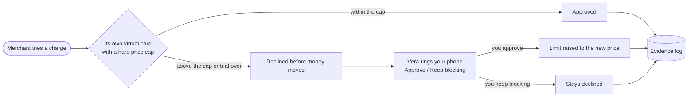
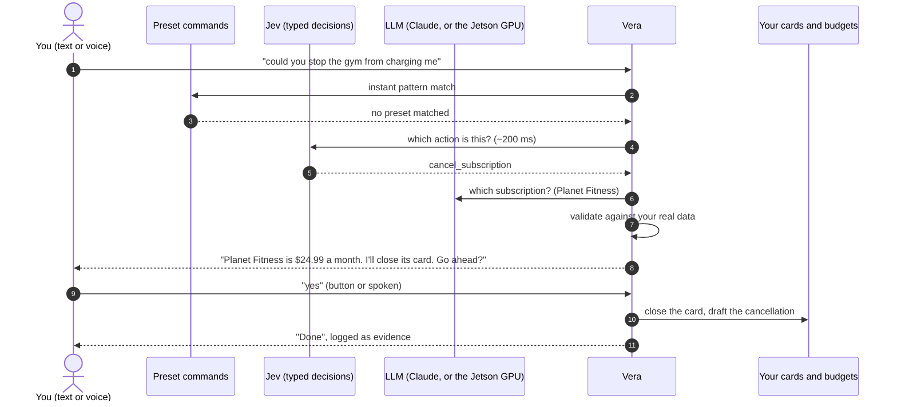
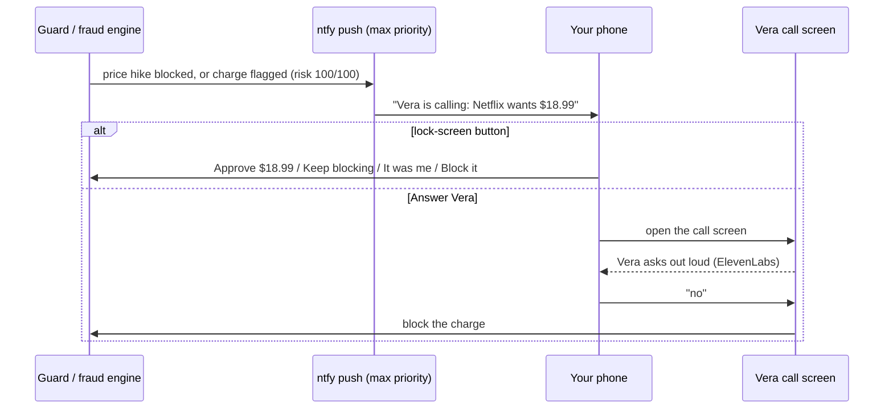
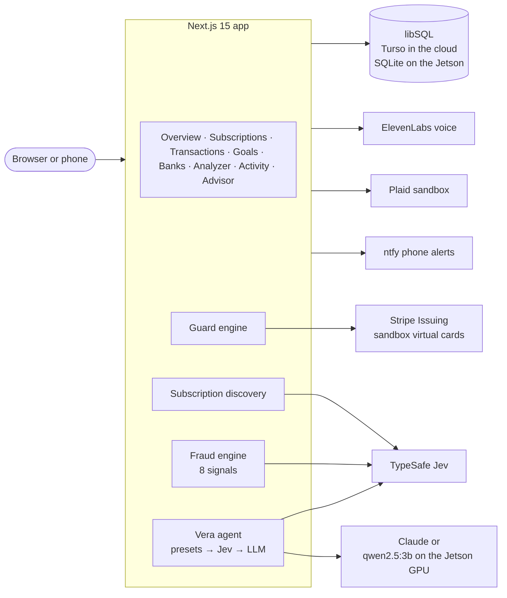
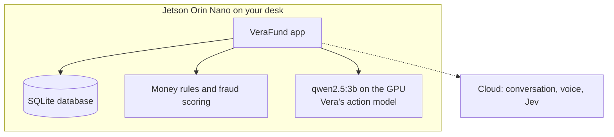
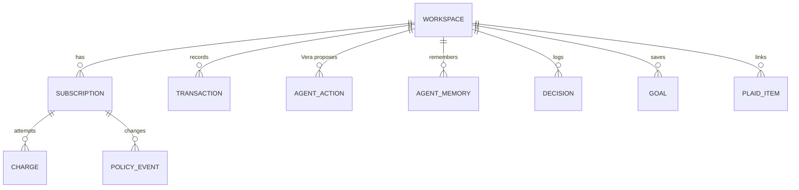

# VeraFund

**Subscriptions that ask before they charge.** VeraFund replaces Rocket Money. Rocket Money tells you about a price hike after you've been charged; VeraFund gives every subscription its own virtual card with a hard price cap, so the hike is declined until you say yes. Vera, the built-in assistant, can act for you by text or voice, and calls your phone when something needs you. The same app also runs on an NVIDIA Jetson, with Vera's action model on its GPU.

**Live:** https://verafund.vercel.app (the login is pre-filled) · **QA:** core flows verified by Seldon's Wren agent (see `wren-results/`)

## How it works



**Rules decide, AI explains, you approve.** Card limits and fraud scoring are deterministic and unit-tested. Jev and Claude rank, classify and explain, but never move money on their own.

## Vera acts only with your yes



Vera can only pick from a fixed menu of actions: cancel (close the card and draft the message), pause, resume, create a card, approve or keep blocking a new price, set a budget, add to a goal, record a debt payment, answer a fraud alert, find and guard subscriptions, and remember facts. Every action is read back, waits for your yes, expires after 5 minutes and runs at most once. Anything else is a conversation.

## Vera calls your phone



Links are signed and expire after an hour. Phone alerts are opt-in per account.

## Architecture



## On your own hardware: NVIDIA Jetson



Your money rules, your database and Vera's action model run on the device. Conversation (Claude), the voice (ElevenLabs), Jev and speech recognition use the cloud.

Measured on a Jetson Orin Nano 8GB (JetPack 6.0, 15 W) with `python3 scripts/llm-bench.py`:

| Model | Decode | Prompt | GPU | Board power | Tool choice |
|---|---|---|---|---|---|
| qwen2.5:3b (Q4_K_M) | **14.1 tokens/s** | 488 tokens/s | 84% | 10.8 W | 3/3 correct, ~3 s each |

## What's inside

| Area | What it does |
|---|---|
| **Subscription Guard** | One virtual card per subscription with a per-charge limit, issued on Stripe Issuing (sandbox). Above-limit charges are declined; trial cards lock when the trial ends. Every decision is logged. |
| **Find my subscriptions** | Scans your history for recurring charges, flags price hikes ("$9.99 → $11.99"), separates bills from subscriptions, and guards the ones you pick in one click. |
| **Vera** | Chat on every page and a hands-free call. Takes confirmed actions, remembers what you tell her, and answers from your real numbers. |
| **Phone alerts** | Price hikes and suspicious charges ring your phone, with answers on the lock screen or by voice. |
| **Fraud detection** | An 8-signal, explainable risk score for every purchase, with Jev triage and "was this you?". |
| **Purchase Analyzer** | Snap a receipt or a shelf tag: item and price fill in, "this costs 3 hours of your life", and a live search for the same item cheaper elsewhere. |
| **Overview, Goals, Banks** | Net worth, cash flow, budgets, savings goals, debt payoff planner, and Plaid bank import. |
| **Decision log** | Every Jev, rules or LLM decision, with its latency, on the Activity page. |

Blocking a card stops charges on that card. It does **not** cancel your contract with the merchant, and the app says so.

## Quality

- 497 unit and integration tests (`npm test`): decision engine, service layer, fraud, discovery, Vera's agent (presets, validation, the confirm flow), phone links, encryption.
- `seldon.yml`: Wren tests for the price hike, the free-trial lock, subscription discovery, and Vera acting only after a yes. Results are in `wren-results/`.

## Run locally

```bash
npm install
npm run dev      # http://localhost:3000
npm test
```

| Variable | Used for |
|---|---|
| `DATABASE_URL` / `TURSO_DATABASE_URL` + token | Turso (otherwise a local SQLite file) |
| `STRIPE_SECRET_KEY`, `STRIPE_FINANCIAL_ACCOUNT`, `STRIPE_CARDHOLDER_ID` | Stripe Issuing sandbox cards (test keys only) |
| `LITHIC_API_KEY` | Lithic sandbox cards, as an alternative network |
| `ANTHROPIC_API_KEY` | Vera's answers, photo reading, price search |
| `TYPESAFE_API_KEY` | Jev typed decisions |
| `ELEVENLABS_API_KEY` | Vera's voice |
| `PLAID_CLIENT_ID`, `PLAID_SECRET`, `PLAID_ENV` | Bank connections |
| `NTFY_TOPIC`, `PHONE_ALERT_SECRET`, `APP_BASE_URL` | Phone alerts |
| `DATA_ENCRYPTION_KEY` | Encrypting bank tokens at rest |
| `LLM_PROVIDER`, `AGENT_LLM_PROVIDER`, `OLLAMA_URL`, `OLLAMA_MODEL` | Running Vera on a local model |

## Self-host on a Jetson (or any Docker host)

```bash
docker run -dit --name ollama --runtime nvidia --network host --restart unless-stopped \
  -e OLLAMA_HOST=127.0.0.1:11434 -v ~/ollama-models:/data/models/ollama/models \
  -v ~/ollama-logs:/data/logs dustynv/ollama:r36.3.0
docker exec ollama ollama pull qwen2.5:3b

docker build --network=host -t verafund .
docker run -d --name verafund --network host --env-file verafund.env \
  -v verafund-data:/data --restart unless-stopped verafund
```

Set `AGENT_LLM_PROVIDER=ollama` and `OLLAMA_URL=http://127.0.0.1:11434` in `verafund.env`. `--network=host` is needed on JetPack 6 with Docker 28+.

## Data model



Money is stored as integer cents everywhere, and each account is an isolated workspace.
